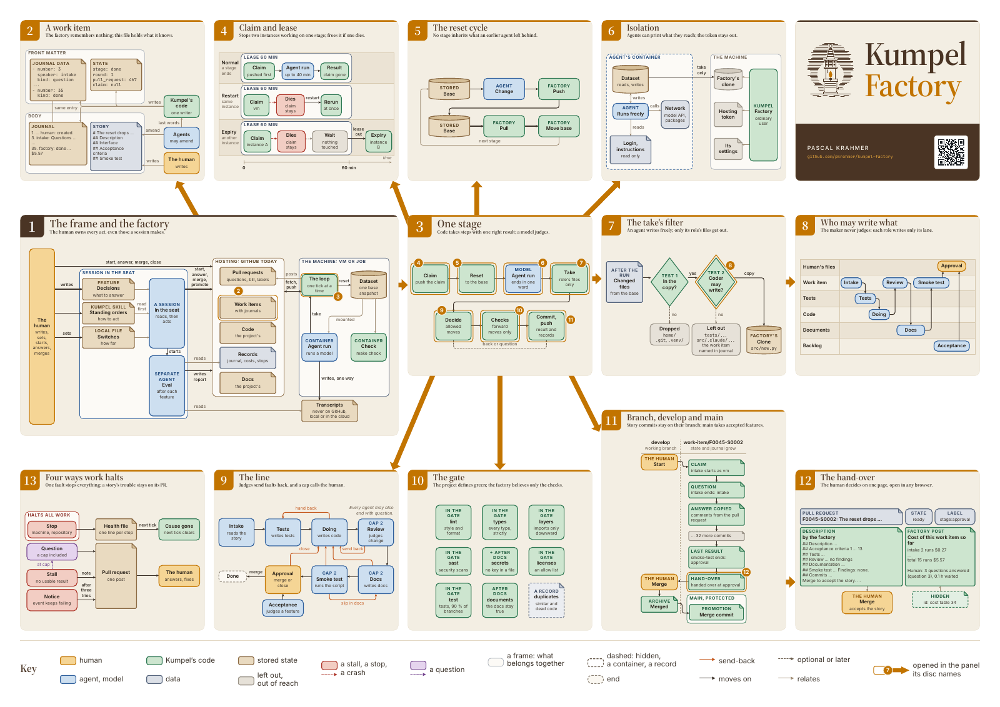
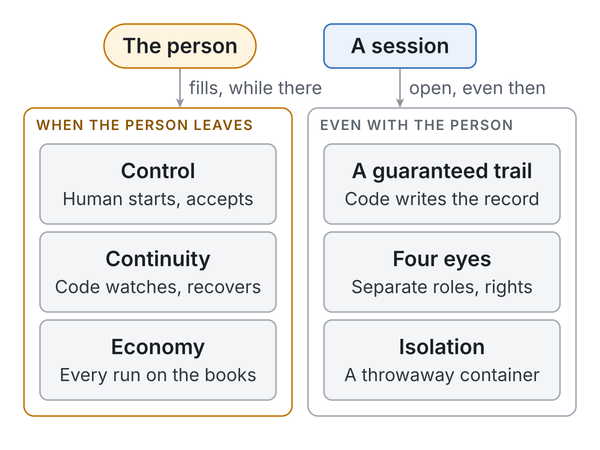
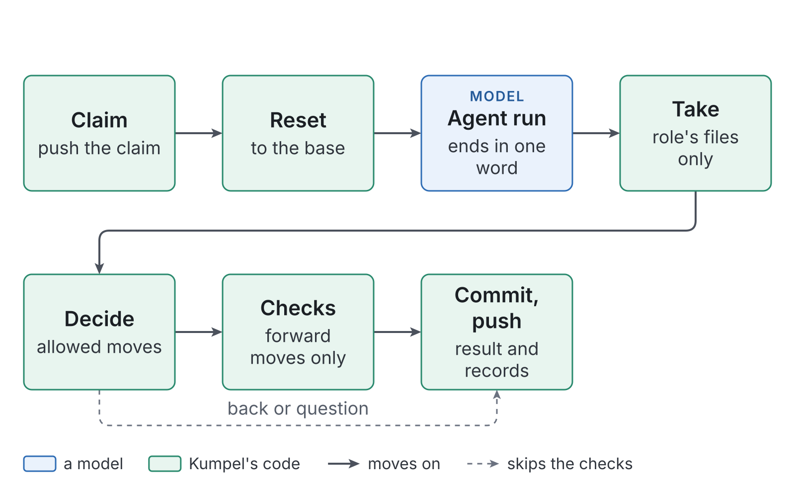
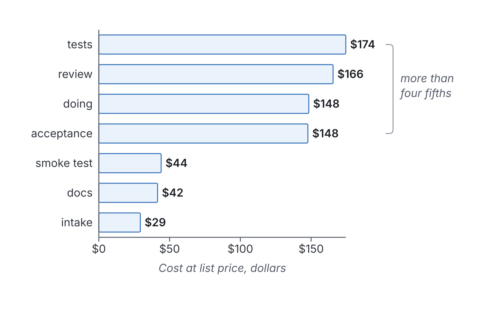
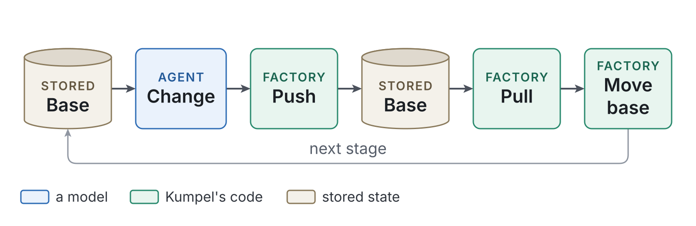
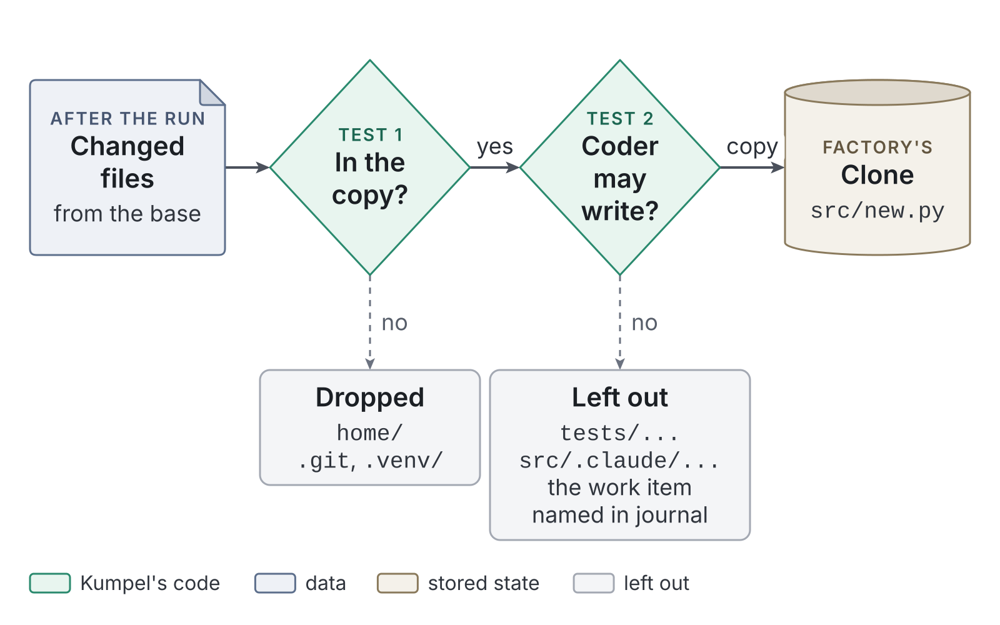
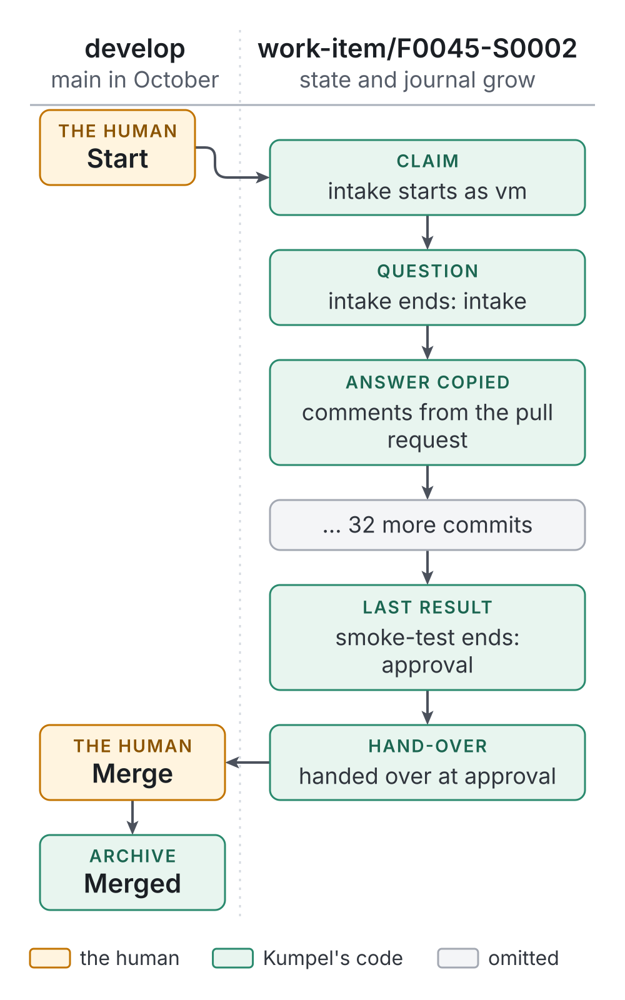

# Kumpel

> This brochure describes Kumpel as of November 2026 (version 1.1). Its figures are a record of that time; the [README](../../README.md) and the guides under [docs/](../) describe the factory as it is now.

*Kumpel is a software factory: coding agents build software one small change at a time, while a person decides what is built and accepts what lands.*

The brochure as a PDF: [Kumpel: the software factory in brief](assets/kumpel-brochure.pdf).

## Kumpel: the software factory in brief

### Kumpel in two minutes

**For everyone**

*Kumpel is a software factory: coding agents build software from short written requests, one at a time, while a person decides what is built and accepts what lands. This spread says what it delivered, what you gain, and how far it has been tried.*

#### While nobody watches

Kumpel builds software while nobody sits at the keyboard, from decisions written down ahead. One night, on its first version, the person who runs it stopped watching shortly before midnight. By five in the morning, 14 changes were built and merged, in 107 agent runs. A session under that person's written orders settled six questions on the way, each within about a minute.

#### What it is

Kumpel is a **software factory**, a program that has coding agents build software one small change at a time while a person stays in charge. A coding agent is an AI assistant that reads code, writes code, and runs commands. The name is German for a mate, and for a coal miner.

A person writes down each wanted change as a short text, a **story**, and signs it off before any code exists. The factory passes the story along a fixed line of agents that question it, test it, write it, review it, document it, and try it out, while ordinary code moves the work, runs the checks, and keeps the books. At the end, the person, called **the human** here, accepts the result or sends it back.

#### What you gain

Six benefits follow from the design, and each comes with its limit.

- **You decide and accept.** No story starts and no change lands without an act you own, though a session may act in your place under written orders, as spread 4 shows.
- **The work goes on while you are away.** Code looks for work every 15 seconds, resumes its own work after a crash, and turns a stuck story into a question. While a question waits for you, nothing else starts.
- **You see every run on the books.** Code writes a cost line for each agent run and sums them into the story's bill, read before you accept: estimated fees, already spent, without your hours.
- **You can trace every change.** What each agent did, why, and what it left open is written into the story's file by code. The factory, a session, and you share one account, and the skill signs a session's acts, so the trail tells them from yours.
- **Two separate judges, a reviewer and your seat.** A reviewer that may write no code judges every change, after another agent wrote the tests first, and your seat, you or a session under your orders, accepts or refuses it. The reviewer runs the coder's model, so it is separate in role and rights, not in model.
- **Nothing an agent writes reaches your repository unless its job may write it.** Every agent works in a throwaway environment on a copy reset before each step, and only the files its job allows come out. Six openings remain, the open network and the readable login first among them, as spread 6 says.

*Figure 1. The six gaps one person with one coding agent leaves open: three jobs go undone when the person leaves, three guarantees are missing even while the person stays, and the six benefits answer them.*

For a company, the records point to one use: a backlog of small written changes, built while nobody watches, at a median of about two dollars a story in estimated model fees, with a trail an auditor can read.

The factory is built for a rented virtual machine in a cloud, about $50 to $55 a month at the operator guide's size, plus the subscription for its agents. Every run in the record was made on the human's own computer, in a container or in a local virtual machine; in a cloud it has so far built only a to-do demo as a test. The agents reach the internet and their own login, never the GitHub token or anything outside their container. The chat in which the human, or a session, reads and answers runs wherever the human is.

> [!IMPORTANT]
> **The factory built itself.** Over 10 days of work in two weeks, the factory built 30 features of its own repository, 208 stories in 2,127 agent runs and 61 hours of agent time. One person decided what was built and set the orders. A session in that person's place answered most questions, about 130 of 152, and made at least 95 of the 275 merges under those orders; the records do not show who made the rest. The model fees came to $750.93 at list price,[^models] an estimate at published rates, not a sum anyone paid, since every run whose login is recorded, 1,878 of 2,127, used a subscription. The median story cost $2.13. Every total here stands at the end of October; by 9 November the records held 43 features, 354 stories, and 3,839 runs, $1,372.83 at list price. Source: the factory's cost records.

> [!NOTE]
> **How far it has been tried.** Kumpel has built its own code and one small demo, a to-do service, both in Python. No project in another language has run yet. A packaged way for a session to run the factory (the skill, spread 4) has had one trial, on the demo. A version of the factory for a company's cloud has built one feature of the demo at work, where the skill has not yet run. This brochure describes Kumpel as of November 2026.

> **The story so far.** When the factory cleaned up between steps, it sometimes left a file empty or cut short, and twice the whole line stood still for it, once for more than ten hours. The human wanted it fixed. A helper session drafted the story in the form every story has: what is wrong, what the fix must look like from outside, numbered checks it must pass, and the commands that try it out at the end. The human read it, signed it off in one commit, and started it with a second. Each spread's box follows this one story a step further.

#### Where to read on

Each spread, a pair of facing pages, can be read on its own, and the ones marked for IT and engineers can be skipped on a first reading. The table says who each spread is for.

| Spread | For | It answers |
| :- | :- | :- |
| 2. One story, start to finish | everyone | what happens to one change, on one page |
| 3. How it works, in one picture | everyone, then engineers | the parts, the line, and who does what |
| 4. Who decides, and who answers for it | everyone, the decision maker, and audit | who owns each act, and what the records prove |
| 5. What it costs, and what it is worth | finance and the decision maker | cash, estimates, and the quality beside them |
| 6. Safe by construction, and its limits | IT, engineers, and audit | what an agent can reach, and what stays open |
| 7. Running it | IT | the machine, the secrets, the stops, and a project's part |
| 8. How we know | everyone who doubts | the evidence, and what is still moving |
| 9. Kumpel, in brief | everyone | the back page: the topics, the repository, and the human |

### One story, start to finish

**For everyone**

*The boxes marked "The story so far" follow one real change through this brochure, one idea at a time. This spread shows that change on one line, and the page the human saw at its end.*

The change went through **stages**, fixed steps that each have one actor with one job, up to the **approval**, where the human merges it or sends it back. After the start, everything between the human and the factory passed through the story's **pull request**, the GitHub page where the factory posts its questions and its bill.

> **The story so far.** Here is the story as the human signed it off, abridged to its title and four of its numbered criteria. It had nine criteria at the start and 13 by the merge, because the intake and the reviewer added four.
>
> - Title: "The reset drops the page cache after the rollback"
> - Criterion 1: "The reset drops after the rollback (...)"
> - Criterion 3: "Only the reset drops (...)"
> - Criterion 4: "The command must name a program (...)"
> - Criterion 8: "`make check` stays green."

Figure 2 lays the path out by the minute. Look at the three dashed lines up to the human, each a question.

*Figure 2. The story's path: from the intake at minute 0 to the merge at minute 61, with three questions, their waits, and one loop of rework after the first review.*

Figure 3 shows the page the human saw at the end. Look for the reviewer's verdict, the smoke test's last line, and the bill.

*Figure 3. The hand-over on the pull request: the story at its approval, with the label, the agents' reports, and the bill, whose last line counts three answered questions.*

The same line builds more than the factory. At work, it built the to-do demo's first feature, four stories and the acceptance, in 2 h 05 min for an estimated $6.72, as spread 8 tells.

> [!NOTE]
> **For engineers: from the records.** Criterion 4, in words: an empty drop command raises an error and a one-word command is accepted, as rows of one table-driven test. The tester wrote that test before the code and ran it red first. The reviewer's finding behind criterion 10, which it added itself: "A here-document with an extra line would pass both rows, for example a second `NOPASSWD` rule or another command in a helper that runs as root." Source: the story's work item.

### How it works, in one picture

**For everyone, then engineers**

*The whole factory fits in one picture, with the repository and its pages on one side and a machine running a loop on the other. Then come the line of stages and its moves, the roles and what each may write, and why code rather than a model keeps the books.*

#### The hosting service and the machine

Figure 4 shows the whole design. On the left is the **hosting service**, GitHub today, which holds the project's repository and the pull requests. On the right is the **machine**, a Linux virtual machine or a managed cloud job, where the factory's loop runs and every agent works in a **container**, a throwaway environment started for one agent run or one check and removed when it ends. Look at the gap between the halves: the factory reaches GitHub only through git and the pull requests. The picture uses three words that spread 6 explains: the dataset is the agent's workspace, the reset puts it back to a saved state, and the take is what is copied out of it.

*Figure 4. The factory at a glance: the truth and the records on the hosting service, and on the machine a loop that runs each agent and each check in a throwaway container and pushes what it keeps.*

Everything that decides what happens next lives in the repository. The machine keeps a disposable copy, put back to the remote at every pass of its loop. One pass is a **tick**: code fetches, reads what the repository and the pull requests show, does at most one thing, and ends. It looks every 15 seconds while there is work and about every two minutes when idle.

A story in progress is a **work item**, the one file that carries its text and everything that happens to it. At its foot grows the **journal**, the numbered record of every start, question, answer, and result. Code writes every entry, and the journal only ever grows.

#### The line and its moves

The stages run in one fixed order: intake, tests, doing, review, docs, smoke test, and the approval. The order lives in the **pipeline definition**, a short file of the project's own that lists the stages, their roles, the checks each must pass, and where work may go next. Code reads it at every tick from `develop`, the repository's working branch, and no agent may change it.

Every agent run ends with one word, its decision: the next stage, an earlier stage, or a question. Code looks the word up in the stage's list. The first entry moves the story forward, any other sends it back, and a question holds it until one comment answers. Figure 5 draws every move of the line; a story that changes only documents takes a shorter route of its own.

*Figure 5. Stages and moves: the forward line, the send-backs that count against a cap, and the one hand-back that counts nothing.*

Each send-back starts a **round**, one loop of rework, and code counts them. In this project, review, docs, and smoke test allow two rounds each, and at the third send-back code stops trying and asks the human. The human's close at the approval counts as a round too.

Stories come in groups. A **feature** is the human's document for a group of stories, with the decisions taken for them, each numbered and each with its reason. When a feature's last story is merged, the factory opens an **acceptance**, in which one agent judges the whole feature and may propose new stories. A feature is judged again once those are built, which is why 30 features had 73 acceptances.

#### Who does what

Each stage names a role, and each role is a fresh agent with its own instructions and its own short list of files it may change. **None of them sees another at work**, only what it left in the repository.

| Role | Reads | Does | May write |
| :- | :- | :- | :- |
| intake | the story, the feature, the rules | asks wherever two coders could read it two ways | the story's file |
| tester | the criteria and the Interface | writes the tests first and runs them red | tests only |
| coder | the story and the tests | writes the code that makes them pass | the code, never a test |
| reviewer | the change against the story | names faults, may add a missing criterion | the story's file |
| documenter | the story's docs criterion | keeps the documents true | documents only |
| smoke tester | the story's smoke test | runs it as written and fixes nothing | the story's file |
| acceptance reviewer | the whole feature | judges it, may propose stories | its report, new stories |

The instructions say the same in plain words. The reviewer's open with "You find and do not fix: you write no code, not even scratch." Code then holds each role to its files after the run, as spread 6 shows.

> **The story so far.** The story went through all seven stages and visited some twice, in 15 agent runs. The intake and the tester each asked before any code existed, and the coder asked once its check turned red, because two of the tester's tests could not both pass and earlier tests now called a command a test machine may not have. The reviewer found no fault in the code but two criteria missing from the story, wrote them in, and sent it back for one round. The second review found "no findings," and the smoke test reported "Findings: none."

#### One stage, mostly code

Inside its container a model reads, judges, writes, and ends with one word, and everything around that run is code. Figure 6 lays one stage out in its seven steps.

*Figure 6. One stage, mostly code: a model acts in one of the seven steps, and code does the other six.*

Kumpel writes down every job a person does at the keyboard, so that code, models, and the human can each do their share.

> [!IMPORTANT]
> **The division of labor.** The human decides what is wanted and accepts the result. Models judge and write. Code keeps the books, which means it does every step that has exactly one right answer: which story is next, whether the checks are green, how often a story went back.

The reason is how each one fails. When code is wrong, it is wrong the same way every time, so one test reproduces the fault and one fix ends it. A model does a bookkeeping step right almost every time, and at hundreds of steps a day "almost" means a new failure every day, each in a new place. In the factory's first version, where agents numbered the record's entries, one entry in seven came out with a bullet where the number belonged.

> No agent moves a story, commits, or pushes. Code takes the agent's last word and checks it against the stage's list. A forward word moves the story only when the factory's own run of the stage's checks is green, and a word that sends work back passes the round count first. A word that is not on the list moves nothing.

#### A crash costs little

Before an agent starts, code takes the stage with a **claim**, a commit pushed to the story's branch, and a restarted loop that finds its own claim reruns the stage at once. A run that ends with nothing usable is a **stall**. It is tried once more, and after the second stall the factory asks the human.

> [!NOTE]
> **Rare, and tested anyway.** The journals of about two hundred finished stories record more than two thousand stage starts, and about one in a hundred ended in a stall or a crash of the loop. All 281 work items together record 10 crashes and not one claim that had to expire. Its tests also kill it on purpose at the dangerous points and check that nothing is lost or done twice.

#### Built by subject

The factory's own code is ordered by subject, not by layer, so a change's place is found by what it is about. Figure 7 shows the seven areas, from the pipeline down to what every area shares. Each has the same three layers inside: rules, use cases, and tools. Sizes are one day's count and drift.

*Figure 7. The factory built by subject, with sizes in lines.*

### Who decides, and who answers for it

**For everyone, the decision maker, and audit**

*The factory takes the human away from the keyboard, not from the decisions, and every act that starts or accepts work is written down. This spread names those acts, what a session may do in the human's place, and what the records cannot yet prove.*

#### The seat and its four acts

The human's part is a role with four acts in two places, which this brochure calls **the seat**. In the repository, the human starts a story. On its pull request, the human answers a question, merges, or closes. No story starts, and no story's change lands, without one of these four. Commits straight to `develop` are the exception, as the limits below say.

The seat may be held by a coding-agent session under the human's written orders, and the human owns every act made there. Its pace sets the line's pace: while any story waits for the human, the factory starts no other work. The longest wait in the records, 6 h 26 min, ran overnight. In a company, the seat should be a role, not a person: whoever may sign a story off and merge, with a named cover who holds the written orders.

#### Every act is written down

Every act lands in the journal. The start is its first entry, "human: created.", which code files under the human's name. An answer on the pull request is copied in as the human's entry, and so is a close. A merge becomes code's last entry, "done (pull request merged)," followed by the bill. Who spoke is data in the file, not words, so no agent can sign as someone else.

#### Merge, send back, or discard

Two ordinary buttons on the pull request, merge and close, give the human three outcomes, because a close means one thing at the approval and another before it. Look at the last column, which says what survives each.

| Act | When | What the factory does | What survives |
| :- | :- | :- | :- |
| Merge | at the approval | archives the story with its bill | everything, on `develop`, then on `main` |
| Close | at the approval | sends it back to the coder, the comment as the finding | the work, the journal, the bill |
| Close | before the approval | discards it, the file back in the backlog | only the text the human wrote |

A discard deletes the story's branch with its journal and its cost lines, so a new start begins with an empty bill. The records hold two closes: one at the approval, for a finding in a test, and one discard, of a story whose test had printed the model provider's key. A session in the seat made both, before the skill existed, the discard on the human's word and the send-back under the human's written orders.

> **The story so far.** Three questions stopped the story, from the intake, the tester, and the coder, and each waited between 79 and 143 seconds. A session in the seat answered all three under the human's written orders, through the human's account. The answer to the coder also gave leave to change the earlier tests the fix needed. The same session merged 11 seconds after the hand-over.

#### A session in the seat

**The Kumpel skill** packages the seat for a session: instructions and small scripts that let a coding agent run the factory beside the human, in a chat. It does three of the four acts: it answers questions, merges once the six points of its orders hold, and starts the next story. It never closes a pull request, so with the skill a send-back and a discard stay with the human.

Each of these acts has a **switch**, a setting only the human sets. With `merge` off, which is the default, the skill posts its verdict and the human merges. Turning `start_next` off leaves it only reporting that the next story is ready. The `answer` switch sets how far it answers: when off, only what the feature's decisions settle, and when on, the default, also beyond them, with those answers marked for the human. Every act gets a line in a log on `develop`. In Figure 8, look at where the session stands, between the orders it reads and the repository it acts on.

*Figure 8. The seat with its orders: the human writes the orders and sets the switches, the session acts only through them, and its log runs back to the human.*

> [!NOTE]
> **The six points, from the night log.** At the merge of the story in these boxes, before the skill existed, the human's night log read: "six checks met (write paths; earlier tests under decision 22 and its widened leave; check green; reviewer no findings, entry 30; Expect met; no markers)." Write paths are the files a role may write, and Expect is the smoke test's expected lines. Source: the night log.

Who may do what comes down to four lists.

- **An agent of the line** may write only its role's files. It never commits, pushes, or sees the hosting token.
- **A session in the seat** may answer, merge or promote while its switch is on, start the next story, and commit to `develop` to fix a small finding or change a file no role may write.
- **Code** moves the work, runs the checks, writes the journal and the cost lines, and alone pushes for the line.
- **The human** writes the features and the orders, sets the switches, and keeps every close while the skill holds the seat.

#### The one account, and the other limits

The factory posts with the human's GitHub token, so the factory, a session, and the human all act through one account, and the records cannot tell them apart by author. A hidden marker tells the factory's posts from the human's comments, and the skill now signs its acts: a Kumpel line under its comments, Kumpel as the author of every commit it makes, and a merge message that names it. The account stays the human's, and the switches keep no history. Any comment written after a question answers it, and the repository sets who may comment: on a private one only the people with access to it, on a public one anyone with an account.

A session's commits to `develop` pass through no tester or reviewer, and the session works outside every container, with the human's rights. `main` takes only accepted features, through a promotion's pull request, and a ruleset keeps every direct push out. For work, the design notes ask for `merge` off and answers only within the feature's decisions.

#### Controls and evidence

For an auditor, the same facts sort into questions, in this brochure's own grouping, each with where its record is and what stays open.

| Question | Where the record is | What is open |
| :- | :- | :- |
| Who started it? | the start commit, and the journal's first entry | one account; the skill's commits name Kumpel |
| Who accepted it? | the merge, the journal's last entry, and the skill's log | the log is the session's own account |
| Did a second judge see it? | the tester's and reviewer's entries, and the factory's own check lines | a session's direct commits skip both |
| Did each agent keep to its files? | the journal names every file the factory refused | changes to the pipeline definition pass no review |
| Who changes the controls? | files in the repository, and the switches on the human's computer | the human, or a session with the same rights; a switch change is recorded nowhere |
| What did it cost? | code's cost lines beside the work item | list price, not cash |
| Can the record be rewritten? | code restores the journal after every run, and the factory's repository refuses squash merges | a discard deletes a story's record |

### What it costs, and what it is worth

**For finance and the decision maker**

*The factory records the price of every agent run, but at list price, which is an estimate and not cash. This spread separates what is paid from what is estimated, shows where the money goes and what bounds it, and sets the evidence of quality beside the cost.*

#### What you pay, and what is an estimate

After every agent run, code writes one cost line from what the agent's runtime reported: the stage, the run's length, its tokens, and its price at **list price**, the runtime's own estimate at the provider's published rates for the model that ran.[^models2] The **bill** is the table code computes from those lines for each story, stage by stage, and posts on the pull request before anyone merges. Read the second column of the table first: only the first two rows are cash, and the third is the human's time.

| Item | Cash or estimate | Amount |
| :- | :- | :- |
| The agent's login, a subscription or an API key | cash | not in the records |
| The machine, the factory's virtual machine | cash | about $50 to $55 a month, from the operator guide |
| The human's hours | time | not recorded |
| One agent run | estimate | median $0.21 in 57 seconds |
| One story | estimate | median $2.13, middle half $1.01 to $3.62, dearest $17.02 |
| One acceptance of a feature | estimate | median $1.90 |
| The whole record, 30 features | estimate | $750.93, about $25 a feature on average, about $16 for the median feature |
| The baseline, eight stories and three acceptances | estimate | $16.10 in 2 h 06 min |

The **baseline** in the last row was a measured rebuild of the to-do demo, with the factory frozen at one version, and spread 8 tells how it failed its own test. Every run whose login is recorded, 1,878 of the 2,127, used the human's subscription, which limits use by time windows, one of five hours and one of a week, not by dollars. A discard deletes the story's cost lines, so the $750.93 leaves out the one story of these 30 features that ran on an API key, about $5 and 40 minutes by the session's estimate at its discard.

#### Rework sets the price

Rework explains most of the spread in price. A clean story is six runs, one per stage, and 79 of the 208 went through that way. Another 21 show no send-back in their final count but took more than six runs, 19 for a question and two for a retry after a stall. Stories that never went back cost a median of $0.99, one round $3.24, and two rounds $6.89. A round reruns the coder, the tester, the coder, and the reviewer in order, and the bill shows it. Stories with more acceptance criteria went back more often, so the round is not the whole cause.

> **The story so far.** The bill on the pull request read 15 runs, 35 agent minutes, and $5.57 at list price, more than twice the median story. From start to merge took 61 minutes, about six of them waiting for answers. The tests stage cost most, $1.98, and the tester's first run, which wrote nearly all the tests, was $1.11 of it. The last line counted the human: "3 questions answered (question 3), 0.1 h waited."

#### Where the money goes

Figure 9 sums the cost of every run by stage. Look at the four longest bars, which hold more than four fifths of the total.

*Figure 9. Where the money goes: the cost of every agent run summed by stage at list price, with tests, review, doing, and acceptance taking more than four fifths.*

Writing and judging split the money about evenly. The tests and the code take about two fifths, and the review of each story and the acceptance of each feature take another two fifths. A minute of review cost about three times a minute of tests. The reviewer runs at high effort, the tester and the coder at medium effort on the same model. The intake, which asks the most questions, is the cheapest stage, at 4% of the total.

#### What bounds the spend

Nothing caps spending in dollars per story or per month, but the subscription's usage windows, the limits on every run, and the machine's fixed price bound it instead. The bounds are of time and count.

- **Per run.** Every run has a time limit, 40 minutes in this project, and a run past it ends as a stall. Its agent's file also sets a money limit, from $1 a run for the intake to $8 for the acceptance reviewer, with the coder at $4. A run that spends it is resumed once with a quarter more, at least $0.50, and stalls only if that runs out too.
- **Per story.** In this project, two rounds per judging stage and two stalls per story, and then code asks the human.
- **Per machine.** One agent runs at a time in each factory.
- **Per window.** The human's orders start a story only while both of the subscription's windows have room, a rule that no code enforces. Those windows steered the schedule more than money did.
- **Per provider.** At the human's workplace, a gateway limits each model to about $3 per 10 minutes. The factory waits such a limit out, for up to two hours, and resumes the same session.

Within those bounds, the dearest story in the record cost $17.02 in 33 runs. That is what happened, not a ceiling the factory enforces.

#### What is not counted

The records hold no price of the subscription and none of the human's hours, spent writing features and stories and reading pull requests. Nothing in them compares the factory with a person doing the same stories, and the baseline compares the factory only with an earlier factory. A pilot in a company would count its own stories' bills, rounds, and the hours of its seat, since the records hold no developer's time to compare with.

The waits are mostly a session's. About two stories in five asked the human something, 85 of the 208, and the median answer came after 1.3 minutes because a session gave most of them. Five waits ran over an hour and held 17 of the 24 hours the line stood still for the human. Against 61 hours of agent work, that is about two hours of standing still for every five hours of work, and a person in the seat would lengthen it.

#### Quality beside cost

Cost is half of the evidence, and the records hold part of the other half.

- **Send-backs.** Of the 208 stories, 108 went back at least once, from a judge or from the human.
- **Feature verdicts.** The 73 acceptance reports open with 41 "accepted," 31 "accepted with stories," and one "not accepted."
- **The human's refusals.** Thirty features hold one close at the approval.
- **The gate.** A forward word moves a story only when the factory's own run of the checks is green. In the factory's own repository, `make check` runs eight tools, from a formatter to a license check, with a type check, a layer check, and a security scan among them.
- **Stalls.** The record holds 14, and 12 were a red check after an agent said its work was done.
- **The judge.** The reviewer writes no code, so it cannot fix a fault quietly.

The records count no faults found after a merge, and no reverts. That is the missing half of the quality evidence.

### Safe by construction, and its limits

**For IT, engineers, and audit**

*Every agent works in a throwaway container on a copy of the project that is reset before each stage, and only the files its role may write come out. Six openings remain, and this spread names each one beside what is closed.*

#### One reset, nothing to clean

Every stage runs on a **dataset**, the file system the agent works on, which holds the project's copy and the agent's home folder. It has exactly one snapshot, the **base**. Before every stage the factory rolls the dataset back to the base, so whatever an agent made, hid, or rewrote goes back with all the rest. Then it brings the copy up to date and moves the base forward, as Figure 10 draws it.

*Figure 10. The reset cycle: the base, the agent's change, the push, the rollback to the base, the pull that brings it up to date, and the base moved forward for the next stage.*

The reset replaced guards that fought each other and stopped the factory five times in one day, under one rule: "Git is the only state between stages, by construction, not by cleaning." A ZFS rollback took a tenth of a second. A cloud job's plain copy takes about 1.6 seconds per gigabyte, and at work its copy steps together cost about nine seconds a stage.

#### Inside the container

Every agent run gets a container of its own, started from the **stage image**, whose tools are pinned and which holds no copy of the factory's code, no `sudo`, and no token. A process inside holds no rights beyond an ordinary user's, and caps of 4,096 processes and four gigabytes keep a runaway test inside. At the time limit the runtime ends the container whole, and the factory's own kill follows 30 seconds later.

The **login**, the token or key with which the runtime calls its model, is lent read-only. The hosting token never enters, because what an agent can reach, it can print. Figure 11 sets what the container reaches beside the gray side it cannot.

*Figure 11. What the agent's container reaches: the dataset, two read-only files, and the network, while the hosting token, the factory's clone, and its settings stay with the factory.*

#### The take is the only way out

After the run, the factory copies out the **take**: the changed files that the agent's role may write, and nothing else. The list of changes comes from the file system, not from the agent. Each role's **write paths**, a short list of file patterns in the pipeline definition, are read as they stood when the stage began, so an agent that edits the definition widens nothing. Figure 12 shows the filter on one coder's run.

*Figure 12. The take's filter: what a coder's run changed, what is dropped, what is left out and named, and what reaches the factory's clone.*

Files outside the write paths, or under 12 protected patterns no definition can open, are refused, named in the journal, and wiped by the next reset. A commit the agent made inside never travels.

> **The story so far.** The story was about the reset itself. Until its merge, a hand-made wrapper on the machine dropped the cache for the stages building its replacement. The pull request's file list shows only files each role may write: the tester's tests, the coder's code and setup script, and the documenter's three documents. A slip of the coder's that ran stray lines in a shell stayed inside its throwaway container.

The checks never run where the agent ran. Each starts in a fresh container on the base with only the taken files, so a leftover cache cannot pass a check or fail it. That is why a passed check can be kept as a **known result**, under a key of exactly what it reads.

#### Closed, and open

Four things are closed by construction: the hosting token stays on the machine, the dataset resets before every stage, only the role's files leave, and in a cloud job a firewall rule, proved by a probe at every start, blocks the cloud's metadata server. Six stay open, in this brochure's own grouping.

| Open today | What limits it today |
| :- | :- |
| The network, kept by the human's choice for the model's API and the package index | Cutting it is a later step, such as a list of allowed hosts. |
| The login, readable inside, so an agent could send it | It is not the hosting token, so nothing inside can push or merge. At work, a gateway caps its spend. |
| Tool calls, which the factory never judges | The runtime refuses a few commands, and only the take leaves. |
| The seat, whose session works outside every container | Switches only the human sets, and a log of every act. |
| One account for the factory, a session, and the human | A hidden marker on the factory's posts, the skill's signature on its own, and its log. |
| Answers, since any comment after a question answers it | A private repository, where only members can comment. |

A company can narrow these openings today. A private repository lets only its members comment, which narrows the opening of the answers to the people who have access. The company's own gateway, which at the human's workplace limits each model to about $3 per ten minutes, and its own login stand between the agents and the model, and the trial at work ran through both, though it hit no limit; and a list of allowed hosts is planned. At work the factory posted with the token of a test user, whose account sees only the repositories chosen for it. The session that drove the trial used the same account, so the trail there still did not tell the factory from the session. Branch protection is now part of the design: the factory commits only to `develop`, to archive a story's file after the merge and to publish its stop records, and `main` takes accepted features only through a promotion's pull request.

The login once proved the point. Under an API login, an agent's test printed the provider's key, the secrets check caught it, and the human's night log records the decision that followed the same day: "the API key idea is given up." Whether the key itself was revoked is not in the records.

As for where data goes, the agents' prompts and the project's files they read go to the model provider the login belongs to, under that provider's terms. No connection comes in from outside. The container only reaches out, to the model's API and the package index, and only the machine holds the hosting token and pushes.

#### The gate

The fence keeps the agent in, and the gate keeps bad work out. A stage ends only when its checks are green, and code runs them, not the agent. In the factory's own project, the whole gate runs once per story, after the smoke test, and the docs stage runs three quick checks. Figure 13 lists them, and a project brings its own checks under the same target names. The secrets scan is the one that caught the printed key told above.

![Ten boxes in four rows: seven green checks of the whole gate, run after the smoke test, lint for style and format, types for every type strictly, layers for imports only downward, sast for security scans, secrets for no key in a file, licenses for an allow list, and test for tests with 90 percent of branches, then two green checks that the factory runs after the docs stage, guides for the tests that read the documents and documents for the docs staying true, and a slate dashed box for the duplicates record, which is not a check; the secrets box is also marked as run after the docs stage.](assets/figures/the_gate.svg)

*Figure 13. The gate of the factory's own project: the whole gate, which the factory runs once after the smoke test, the three checks it runs after the docs stage, and the duplicates record, which stops nothing.*

### Running it

**For IT**

*The factory runs as one service on one machine for one project, with three secrets the human places by hand.*

#### What runs where

On a Linux virtual machine, the factory is a service that restarts 15 seconds after any exit, with a ZFS pool for the dataset and Podman for containers without root. One setup script builds it from a fresh Ubuntu machine. Where a company's cloud allows no virtual machine, the same loop runs as a Cloud Run job, which builds what it needs at every start.

| | On the virtual machine | In a Cloud Run job |
| :- | :- | :- |
| A start | the service starts at boot | a script installs and builds, for a few minutes |
| The base | a ZFS snapshot | a plain copy of the folder |
| The containers | without root | as the job's root, every right dropped |
| The machine's own files | kept between starts | lost at each start |
| How long it runs | until stopped | a day at most, set shorter by the human, and ended by the idle shutdown |
| How far it is tried | the factory's own build | built and accepted, tried once at work |

The job has run once at work, in the trial spread 8 tells. Failed starts before it found small defects, which a finished feature has since fixed. The values that belong to one company sit in one plain file outside every repository, from which one script creates, starts, watches, and deletes the job; the secrets stay files the human places.

One instance, the running factory with a name, serves exactly one project and runs one agent at a time. The operator guide's machine is a cloud virtual machine with two processors and 8 GB of memory, at about $50 to $55 a month; the record's own virtual machine ran on the human's computer, and in a cloud the factory has so far built only a to-do demo as a test. A cloud job defaults to four processors and 16 GB, which the site file sets, and no price is recorded. The virtual machine made 474 of the record's 2,127 runs, and an earlier instance the rest.

The factory runs as one ordinary user, root only for a cache-drop helper, four ZFS commands with an optional fallback, and the idle power-off. The hosting token is the human's own GitHub token in one file, whose folder is the only fence; the guides do not state its scopes.

#### Three secrets, placed by hand

The setup script stops halfway on purpose and waits for three secrets that only the human places: the hosting token, the agent's subscription token, and a file for an API key, which stays empty while the agents use the subscription. Each is made by hand in that user's folder, and only the login is lent to a container, read-only. A token that expires shows as a stop at the next fetch, and the human renews it. In a job the secrets live in the company's secret store, and the plain site file holds only their names and an optional token command, never a secret.

#### Proving the machine before work

A bad setting is refused at start, with one line that names it. Then the **preflight** checks the machine before any work: the tools, the hosting service, the installed agent files, the runtime's pinned version, and the token folder's permissions. On the virtual machine it also looks for the container runtime, the dataset, and the stage image. Its last item is one real agent call, with a budget of $0.10 and two minutes. Whenever `develop` has moved, the factory also runs the project's lint there, its quick check of style, and a red result halts new work. Before any job exists, the site's check runs eleven read-only checks; only the job's own preflight proves the model login.

#### Four ways work halts

Four things can halt work, and only one of them halts the factory for a fault. That one is a **stop**, a fault of the machine or the repository, such as a full disk or a red `develop`, which halts all new work until the factory finds its cause gone. The table says where each kind shows and what clears it.

| What halts | Where it shows | What clears it |
| :- | :- | :- |
| A stop | the health file, and a record on `develop` | the first tick that finds the cause gone |
| A question | the story's pull request | one comment written after it |
| A stall, twice | the pull request, then a question | the human's answer |
| A notice, after three failures | the pull request | the human fixes the cause |

*Figure 14. Four ways work halts: only a stop goes to the health file and clears itself, while a question, a stall, and a notice go to the work item's pull request.*

Stops were rare. In the record the machine stopped nine times, for about 13 hours in all. Seven came from the factory's own machinery, five of them from guards that fought each other, and each cause was fixed.

> **The story so far.** The two halts in the first box were stops of this kind: each time, the check of the working branch, then still main, had turned red. Each stop cleared itself once that branch was green again, and the story that fixed the cause took 61 minutes.

#### Nothing pages you

The factory has no dashboard and builds no watchdog. The service manager restarts a process that died, and any alerting beyond that is the human's. The human watches plain views: the board of every work item, the health check, which prints `healthy` or one line per stop, the factory's log, the bills, the stop records, and the pull requests.

An idle shutdown, off unless the human sets it, powers the machine off after a stretch of idle minutes; waiting for the human counts as idle. In a job it ends the run instead. A machine stop that has stood for ten minutes in a job ends the factory's process with a failed status, and the execution ends as failed.

#### What a project brings

A project brings four make targets in its Makefile. `check` runs the whole gate, `lint` and `test` run its style checks or its tests alone where a stage needs only part of it, and `sync` installs what a fresh copy needs. It brings its pipeline definition and two **forms**, one for its stories, which code checks before every stage, and one for the human's features, which it does not. If it wants, it brings its own agent for any role, which replaces the shipped one whole, and skill files that teach its agents its ways. Its tools must fit the base image, which holds git, make, the Python tool uv, and the one agent runtime the instance uses, about 0.58 GB with Claude Code.

The factory knows `make check`, not what it checks. It runs the project's own commands in a clean container and believes their exit status, so the design knows no language, layer, or framework. Only Python is proven, though. Make is the only door to a build so far, the base image carries the tools of a Python project, and the fixed list of protected paths names Python's files. Another stack is the test still to come.

A new project starts from the **template**: a pipeline definition, a rules file, and a Makefile.

### How we know

**For everyone who doubts**

*Every claim in this brochure comes from records the factory wrote while it built itself. This spread says what those records are, how one measured trial failed its own test, which rules the numbers forced, and what is still moving.*

#### The factory built itself

A first version of the factory was written in three days by a coding agent working with the human, and tested on a small to-do service. That version built the second, which has since built its own repository, more than two hundred stories so far. The evidence is therefore the factory's own, on a Python repository it wrote, which is its strength and its bias.

#### Records anyone can read

The factory keeps no database. Everything it knows is in the repository as readable text: each work item with its journal, its cost lines, and the stop records. The records others read have a published, versioned shape, the **records contract**, whose major version rises when a change could break a reader.

> **The story so far.** Everything in these boxes comes from the story's records: its file with 35 journal entries and as many data records, its 15 cost lines, its pull request, the stop record, and the human's night log. Figure 15 shows where its commits landed. The feature's acceptance kept one loose end in view, a crash of the type checker after the merge: "So the cache drop did not end it, or the crash has another cause. This is for the human to watch."

*Figure 15. The record on its branch: the story's start, merge, and archive on the working branch, main in October, and the 37 commits of its run on its own branch.*

#### A baseline that failed, and said so

The baseline rebuilt the to-do service in an empty repository: eight stories and three acceptances, 67 runs, $16.10, and 2 h 06 min, with no question and no stop. It failed two of its four conditions. The first feature's acceptance was refused on the acceptance reviewer's own advice, and the human's word was "refuse, keep measuring."

> [!NOTE]
> **Three seconds, reported.** The other failed condition was time. A compared story might take up to 125% of the earlier build's agent minutes, a limit of 2.875 minutes, and it took 2.93, which is 3.2 seconds over, while another factory shared the computer. The report could have rounded that away. It recorded the failure and called it weak evidence, noting that on cost both compared stories were 5% to 8% cheaper than before. Later builds of the demo have measured newer versions since. Source: the baseline and measurement reports.

> [!NOTE]
> **The fourth trial, at work.** After the first version's own build, the shakedown on the demo, and the baseline, a Cloud Run job in a company's cloud built the to-do demo's first feature, four stories and the acceptance, with opencode and one model behind the company's gateway. It took 2 h 05 min and $6.72 at the per-token prices the human set, an estimate. Nothing stopped, crashed, or stalled, nobody was asked anything, and the idle shutdown ended the job. Source: the trial's report.

#### Numbers that changed the design

Several rules exist because a number demanded them.

- **A standing leave.** In an early trial, three stories caught between two rules about shared test helpers cost about three times what clean passes would. One sentence now lets such a helper move without asking, a **standing leave**, written once for every story.
- **The reviewer's own criteria.** Questions about criteria that needed no code kept reaching the human, so the reviewer may now write such a criterion itself. The first 19 stories reached the round cap twice, the 189 after the change eight times. The samples are small, and the rounds themselves did not fall.
- **The known result.** Almost half of the factory's checks, over 17 stories, had run on code that already passed. Keeping passed results saves about a minute per story.
- **Mutation testing.** Inside acceptances it ran up to nine minutes a run and still left mutants unchecked, so after four days no stage runs it, and the human starts it as a sweep.

#### The shape of the record

Figure 16 shows all 208 stories by cost. Look at the long tail.

*Figure 16. What a story costs: 208 stories by list price in whole dollars, most of them under three dollars, with a long tail and the median marked.*

#### What is in flux

The table sorts the parts by how far they have been tried.

| How far | What |
| :- | :- |
| Proven in the records | the line, recovery, and the bill, in the factory's own build, and the reset and the take in the virtual machine's runs |
| Tried once | the Kumpel skill, on a copy of the to-do demo, and the Cloud Run job, which built one feature of the demo at work |
| Proof of concept | the timeline, a client that draws the records as a path through the stages |
| Planned, or a later step | several factories on one machine, a first project outside Python, a list of allowed hosts, and an eval: an agent that reads a feature's records and transcripts for the human's next planning |
| Named, with no design | a planning stage, and other kinds of work such as discovery |

### Kumpel, in brief

**For everyone**

*Kumpel is a software factory: coding agents build software one small change at a time, while a person decides what is built and accepts what lands. It built itself, 208 stories in 10 working days, with every run on the books and every change on a written trail. This brochure shows how it works, what it cost, what it keeps safe, and what is still open.*

#### The repository

The factory lives at [github.com/pkrahmer/kumpel-factory](https://github.com/pkrahmer/kumpel-factory). Its documenter keeps the four documents at the top true; the rest is the record itself.

- `README.md`: What the factory does and how to run it, in a page.
- `docs/operator-guide/`: The operator guide, one topic per file: machine, secrets, preflight, stops.
- `docs/decisions.md`: The reason for every design, with the options rejected.
- `docs/project-guide/`: The project explained to the agents that build it.
- `docs/runs/`: The baseline report and the logs of the runs.
- `factory/archive/`: Finished features and stories, with journals and cost lines; open ones stay under factory/features/.
- `operator/skill/kumpel/`: The Kumpel skill: the seat for a session, its orders and scripts.
- `agents/`: The seven roles' instructions, each with its model and money limit.
- `LICENSE`, `NOTICE`: The Apache License 2.0, and the copyright notice.

#### The human

Kumpel is Pascal Krahmer's work, and the human in this brochure is Pascal Krahmer. Reach him at [github.com/pkrahmer](https://github.com/pkrahmer). The wanting, which starts every story and accepts every result, stays with the human, one shift at a time.

The book, the brochure's source, and the poster's source are work in progress in a separate repository.

[^models]: The agents ran under Claude Code on Anthropic's Claude Opus 5.5 for the tester, the coder, the reviewer, the smoke tester, and the acceptance reviewer, and on Claude Sonnet 5.5 for the intake and the documenter, as the agents' files set them through October and the baseline's transcripts confirm. Every list price in this brochure is at those two models' published rates. The trial at work ran one other model through the company's gateway.

[^models2]: The models behind every figure here: Claude Opus 5.5 for the tester, the coder, the reviewer, the smoke tester, and the acceptance reviewer, and Claude Sonnet 5.5 for the intake and the documenter, under Claude Code, at those models' published rates. The trial at work ran one other model through the company's gateway, at the rates in that job's own settings.
